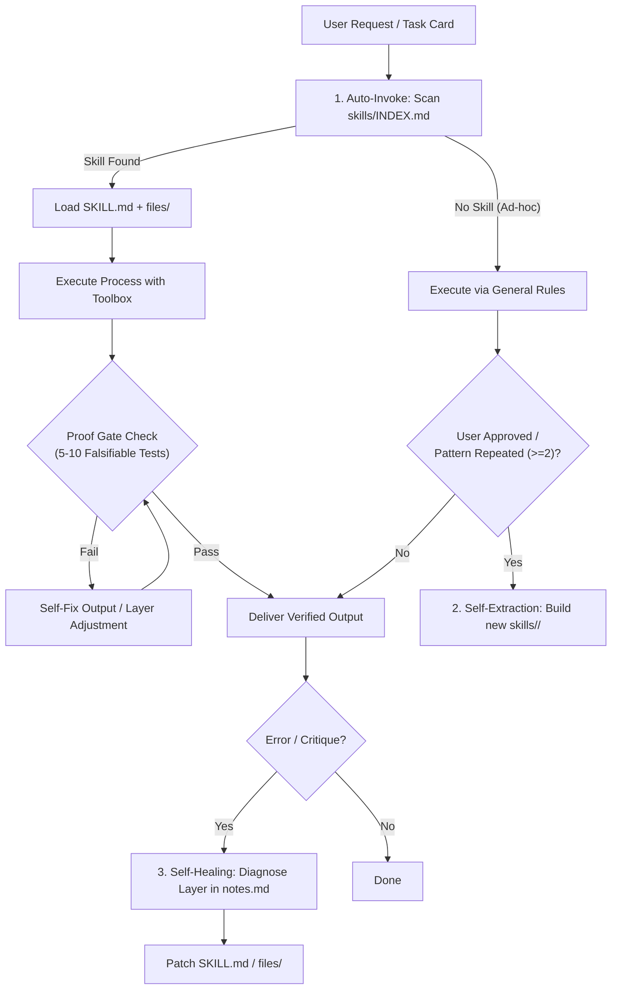

# 08 — AUTONOMOUS SKILL LOOP & DELEGATION PLAYBOOK · 자율 스킬 루프와 위임 플레이북

## 1. CORE PHILOSOPHY · 핵심 철학
- **EN**: Stop spawning separate agents for every single job. Multi-agent chaining is brittle. Instead, maintain a single frontier agent backed by **modular 3-layer job manuals (Skills)**. When a job needs doing, the agent loads that skill, runs its deterministic tools, and validates against objective proof gates.
- **KO**: 일마다 에이전트를 새로 만들지 마라. 멀티 에이전트 체이닝은 쉽게 부서진다. 대신 범용 프론티어 AI 하나를 두고 **일 단위 3단 레이어 매뉴얼(Skill)**을 캡슐화하여 위임하라. 작업 시 해당 스킬을 로드하고, 기계적 도구를 쓰며, 객관적 증명 게이트로 자체 검증한다.

---

## 2. THE THREE LAYERS OF A SKILL · 스킬의 3단 레이어

```
skills/<job-id>/
├─ SKILL.md              # Layer 1: Process (Trigger, steps, rules, Proof checklist)
├─ files/                # Layer 2: Toolbox
│   ├─ INDEX.md          # 1-line manifest of tools & templates
│   ├─ *.py / *.sh       # Deterministic scripts (data pull, parser, calc)
│   ├─ *-template.md     # Skeleton with [PLACEHOLDER] brackets
│   └─ tone-rules.md     # Domain rules & constraints
├─ examples/             # Layer 2: Toolbox - Few-shot goldens
│   └─ YYYY-MM-DD-good.md# Previously approved, high-quality deliverables
└─ notes.md              # Self-healing journal: error -> layer diagnosis -> fix
```

### Layer 1: Process (프로세스 — `SKILL.md`)
1. **Trigger & Purpose**: Exactly what words/events trigger this skill.
2. **Inputs & Locations**: File paths, parameters, or upstream cards.
3. **Numbered Steps**: Step-by-step decision rules ("If X then Y").
4. **Exception Handling**: Past pitfalls and edge cases.

### Layer 2: Toolbox (툴박스 — `files/` & `examples/`)
1. **Deterministic Scripts**: Python/Bash scripts doing mechanical extraction or arithmetic (do not let LLM recalculate by hand).
2. **Bracketed Templates**: Structural markdown/json templates with explicit `[PLACEHOLDER]` fields.
3. **Reference Data**: Fixed naming standards, codes, account IDs.
4. **Golden Examples**: Full, approved deliverables demonstrating exact tone and structure.

### Layer 3: Proof (증명 — 객관적 완료 검증)
- **Zero Subjectivity**: Never accept LLM's subjective claim ("looks complete", "well-written").
- **External Falsifiable Verification**: 5–10 checklists that can fail based on observable facts:
  - Numerical consistency with raw data files.
  - Link/anchor validity.
  - Test suite pass exit code `0`.
  - Zero unresolved brackets (`[PLACEHOLDER]`).
  - Strict identifier compliance (`Code — Name`).

---

## 3. AUTONOMOUS SKILL LIFECYCLE · AI 자율 운영 라이프사이클



### 1. Auto-Invoke (스킬 자동 로드)
- At session start, check `skills/INDEX.md` alongside `tasks-index.md`.
- If a user prompt matches a skill trigger, load `SKILL.md`, execute steps, and enforce the Proof Gate prior to printing output.

### 2. Self-Extraction (스킬 자가 승격)
- When a task succeeds with high satisfaction or repeats $\ge 2$ times:
- The AI autonomously creates `skills/<new-job-id>/` from `skills/_template/`.
- Replace project-specific variables with bracket placeholders.
- Register the new skill into `skills/INDEX.md`.

### 3. Self-Healing Loop (자가 치유 및 레이어 진단)
- When output is flawed or criticized, never apologize blindly in chat.
- Diagnose which layer failed:
  - **Process Failure**: Missing step, wrong ordering, missing branch rule -> update `SKILL.md`.
  - **Toolbox Failure**: Stale template, broken script, wrong placeholder -> fix `files/*`.
  - **Proof Failure**: Defect slipped through because no test caught it -> add a new test to Proof checklist.
- Append a timestamped entry to `notes.md`.

---

## 4. INVARIANT 16 · 불변식 16
- **INV17**: **Recurring operational jobs must be encapsulated in 3-layer skills and self-governed by the AI.**
  The AI must verify outputs via falsifiable Proof Gates before delivery, and persist corrections directly into skill files rather than ephemeral chat turns.
